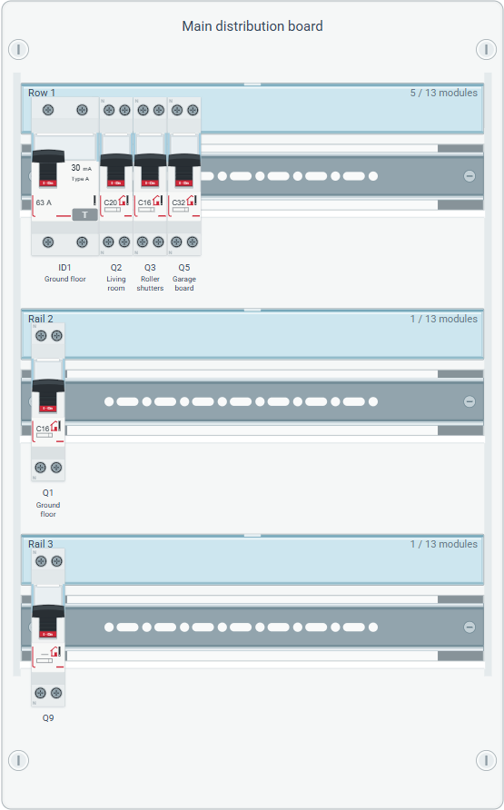
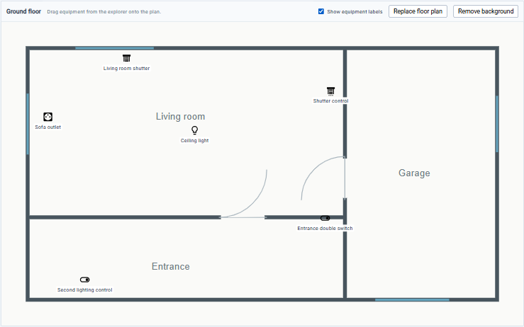
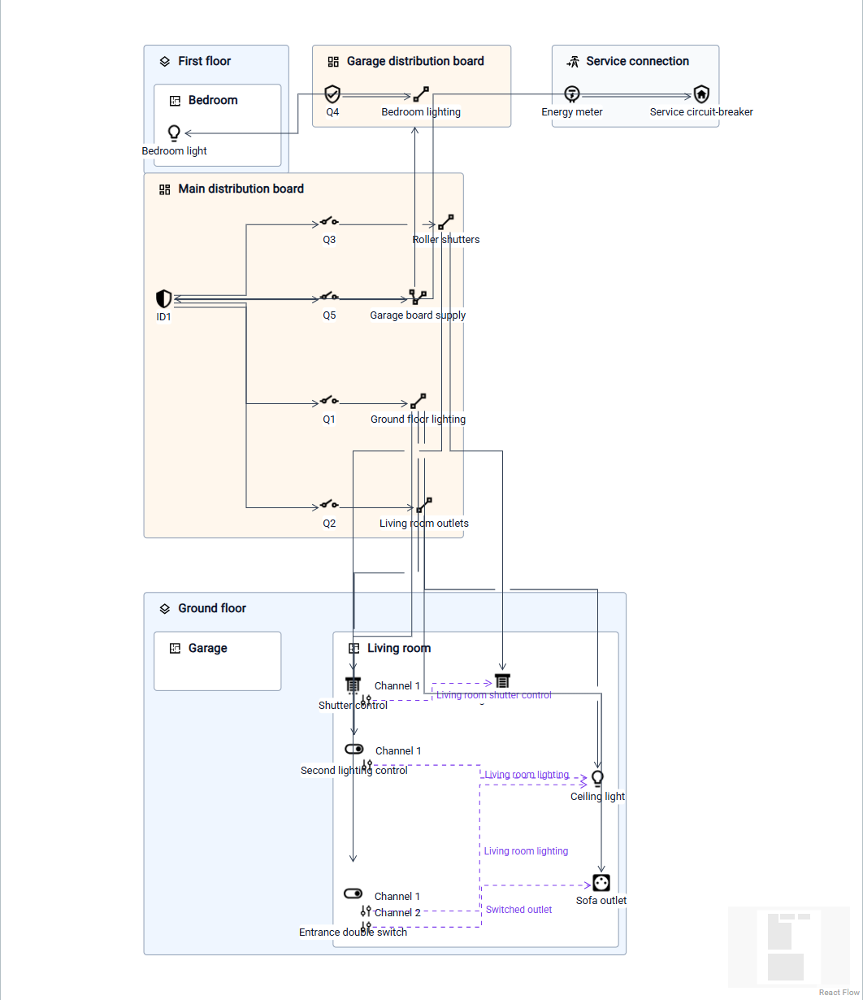

<!--
Copyright (c) 2026 Laurent Redor.
This program and the accompanying materials
are made available under the terms of the Eclipse Public License v2.0
which accompanies this distribution, and is available at
https://www.eclipse.org/legal/epl-2.0/

SPDX-License-Identifier: EPL-2.0
-->

# HED - Home Electrical Designer

A Sirius Web modeler for residential electrical installations. English is the default language; French domain translations are included.

> **Developed with Codex:** This modeler was implemented by OpenAI Codex, under Laurent Redor's direction and review.

The initial scope covers rooms, outlets, control devices, electrical loads, distribution boards, DIN rails, protective devices, final/distribution circuits and their branches, functional controls and an editable device catalog. Equipment and circuits use a single name. Modular devices take their technical specifications from their catalog type and must be mounted on a rail within its capacity. This is a design and documentation tool; it does not certify compliance with NF C 15-100.

## User guides

Read the [English user guide](doc/user/en/index.adoc) or the [guide utilisateur en français](doc/user/fr/index.adoc) for project creation, catalog editing, circuit associations, tables and diagrams. Both illustrated guides are also bundled with the application: the top-right **Help / Aide** menu opens the guide in the configured application language, with a link to switch languages. No documentation hosting is required.

New sample projects use that same creation language for their names. Existing and user-edited names remain unchanged.

For a first installation, follow the step-by-step [Windows/Docker installation guide in English](doc/user/en/index.adoc#installation) or [l’installation pas à pas en français](doc/user/fr/index.adoc#installation). Users download only [compose.run.yaml](compose.run.yaml) and the public `ghcr.io/lredor/hed` image, without compilation, a GitHub account or a package token. The maintainer must complete the first publication and make the package public before this distribution is available.

## Domain build

Requirements: JDK 21 or later and Maven 3.9.9 or later.

```sh
mvn verify
```

The model and edit adapters are generated from the Ecore source. Regenerate from the repository root:

```sh
mvn -f tools/codegen/pom.xml compile exec:java
mvn verify
```

Commit the generated sources alongside Ecore changes. Handwritten domain operations and validation live outside the generated package.

The generator sets `GenModel.copyrightText` so generated model and edit sources retain the copyright and SPDX license headers after regeneration. `copyrightFields` stays disabled; the full EPL-2.0 notice is emitted in file headers rather than as Java constants. The generation entry point also normalizes generated Java to four-space indentation with explicit conditional/loop braces, and formats its XML metadata as UTF-8. `.editorconfig` defines shared encoding and indentation conventions.

See [the metamodel and editing rules](doc/metamodel.md).

## Sirius Web application

The `application` Maven profile adds the Sirius Web 2026.9.0 backend and the standard React frontend. It provides empty/sample dwelling templates, the domain explorer, contextual creation and deletion, editable properties, four electrical tables, domain validation and local pictograms.

Build the frontend before packaging the application, then run it against PostgreSQL. See [building, configuration and the first modeling workflow](doc/development.md). English is the default; set `HED_LOCALE=fr_FR` for French. New catalog names use the creation language and remain editable user data afterward.

## Docker launch

Once the public image is available, start it with PostgreSQL using:

```sh
docker compose -p hed -f compose.run.yaml pull
docker compose -p hed -f compose.run.yaml up -d --wait
```

Open [HED](http://localhost:8080). English is the default; put `HED_LOCALE=fr_FR` in a local `.env` file for French. Keep the same installation name to retain its database volume. The initial image is Linux amd64; ARM hosts need emulation.

Developers can still build from source with `compose.yaml`, which requires package credentials. See [both Docker workflows](doc/docker.md) and [GitHub Packages access](doc/github-packages.md).

## Continuous integration

GitHub Actions checks formatting and tests the domain modules for pushes to `master` and pull requests targeting it. Repository branches also run the full application build, including TypeScript checks, frontend assets, both user guides and the Java application tests. Two parallel Playwright jobs reuse its JAR to run the browser workflows in English and French, each with a fresh PostgreSQL database. Test counts, individual results and failure details can be read directly in each workflow run's **Summary**. Raw reports, browser traces and the executable JAR are also available as workflow artifacts for 7 days. See [workflow setup, GitHub Packages credentials and external contribution checks](doc/continuous-integration.md).

The full build also measures Java-test coverage with JaCoCo. Its Summary shows line and branch coverage per module, excluding EMF-generated code. The **java-coverage** artifact provides the HTML source report and aggregate XML. This first baseline has no minimum coverage gate; see [coverage scope and local commands](doc/continuous-integration.md#java-coverage).

Vitest and React Testing Library check HED's custom frontend representations, with V8 coverage for conversion/layout, rail drops, floor-plan controls and view-removal confirmation. Results and coverage are shown in the same workflow Summary; HTML and LCOV are retained in **frontend-coverage**. See [frontend test scope and local commands](doc/continuous-integration.md#frontend-tests-and-coverage).

## Model Explorer

Use Model Explorer to create, rename and delete model elements, inspect their properties and open saved representations.

The electrical-installation explorer opens automatically; the generic explorer is removed when this domain explorer is available. Its root is the native project name, with **Dwelling**, **Electrical service area (GTL)** and **Device catalog** beneath it. Storeys, rooms and functional controls are under Dwelling; the service connection, distribution boards and circuits are under the GTL. The catalog separates **Distribution board devices** from **Terminal equipment**.

Create a distribution board from the GTL, then rails on the board and modular devices directly on a rail. See [the hierarchy and contextual creation menus](doc/model-explorer.md).

Drag a modular device type from the catalog onto a DIN rail in Model Explorer or the Distribution Board Layout to append a new modular device. The type stays in the catalog and the rail must have enough capacity. See [catalog drops](doc/model-explorer.md#create-modular-devices-from-the-catalog).

Drag a **Terminal equipment** type from the catalog onto a **Room** in Model Explorer to create an outlet, control device or load assigned to that room. Its initial name is the catalog type's current stored name. See [terminal equipment catalog drops](doc/model-explorer.md#create-terminal-equipment-from-the-catalog).

Rail-mounted modular devices display **Name - Device type name**, for example `Q1 - MCB C16 A`. Rename edits only the modular device name. See [explorer labels and editing](doc/model-explorer.md).

Creation menus respect the remaining rail capacity, including compact custom catalog types. See [creation choices and rail capacity](doc/model-explorer.md#creation-choices-and-rail-capacity).

The root expands automatically when the project opens. Use **Navigate to device type** from an installed device's menu or the button beside its type selector in Details to select and reveal that type in the catalog.

See [reordering circuits, rails and mounted devices](doc/explorer-reordering.md) for Model Explorer movement commands. Circuits also support drag-and-drop before a peer or onto the Circuits group to append them.

Create branches below final circuits and associate existing devices by dragging them onto a branch or editing Properties. Devices retain their room and also appear under their branch. The Circuit Diagram shows their supply through that branch, and the Equipment Table includes a Branch column. See [circuit branches and associated devices](doc/model-explorer.md#circuit-branches-and-associated-devices).

Branches are optional. A final circuit's **Associated equipment** list in Details is editable without branches and becomes the read-only union of branch members when branches exist. The first branch receives the circuit's existing devices; removing the last branch restores direct editing. Circuits with branches require association through a branch. Removing equipment from a branch, or deleting its branch while others remain, clears its supply assignment and retains the device and its room.

The explorer's native **Filters** menu includes **Highlight equipments not in floor plans**, disabled by default. Enable it to show room equipment missing from every floor plan of its storey in red, along with its room, storey and dwelling. The parent labels remain red when collapsed. See [the optional placement highlight](doc/model-explorer.md#optional-floor-plan-placement-highlight).

**Highlight incomplete circuit elements** marks circuits without protection, terminal equipment without a circuit and unused board modules, together with their explorer parents. Both highlights start disabled; enabling either one switches the other off. See [the circuit completeness highlight](doc/model-explorer.md#optional-circuit-completeness-highlight).

### Model pictograms

The explorer, creation menus and reference selectors share the local [Material Design Icons selection](doc/icons.md), with visual previews and author credits. The SVGs retain their upstream licenses.

## Representations

The same residential electrical model can be viewed through several representations. Each representation is associated with a model element and shares its data with Model Explorer and Properties. Table columns can be resized to suit the information being displayed. Create a view using **New representation** on its owner in Model Explorer. Saved representations appear beneath that owner and can be opened, renamed or deleted there; deleting a representation preserves the model element.

See [table creation and editing](doc/tables.md) for the available columns and editing rules.

### Equipment Table

Create this table on a **Dwelling**. It lists terminal equipment, rooms, catalog types, circuits, functional controls and power ratings. Names and power ratings can be edited inline.


### Circuit Table

Create this table on a **Dwelling**. It shows circuit uses, source boards, protective devices, conductor cross-sections and served equipment. Names and conductor cross-sections can be edited inline. The **Phase / supply** column and circuit phase selectors appear only for an explicitly three-phase general supply; hidden values are retained.


### Distribution Board Table

Create this table on a **DistributionBoard**. It shows rail assignments, catalog types and protective-device specifications. The read-only **Upstream protection** column shows each device's direct supply (RCCB or service circuit-breaker). Names and label text can be edited here; catalog-owned specifications remain read-only on instances.


### Device Catalog Table

Create this table on a **Catalog**. It lists the available device types, their ratings, module widths, manufacturers and product references. Editing a type updates the specifications displayed for its instances.


### Distribution Board Layout

Create this diagram on a **DistributionBoard**. The SVG cabinet contains DIN rails and modular devices in model order, with widths taken from their catalog types. Move devices by drag-and-drop and use the Model Explorer commands to reorder rails. See [diagram editing and Canva artwork](doc/distribution-board-layout.md).



### Floor Plan

Create this diagram on a **Storey**. Import a PNG, JPEG or SVG background, then drag existing equipment from that storey's rooms in Model Explorer onto the plan. Pictograms are frameless **24 × 24** nodes with free placement. Labels are hidden by default; a filter displays them outside the icons. Each representation saves its own layout. See the [floor-plan workflow](doc/floor-plan.md).



### Circuit Diagram

**Experimental representation.** This diagram is expected to evolve, and future changes may cause existing circuit diagrams and their saved layouts to be lost. Limit its use for now and avoid investing time in diagrams you need to retain.

Create this diagram on the **Dwelling** using **New Representation → Circuit Diagram** (French: **Logement → Nouvelle représentation → Schéma des circuits**). It shows storeys and rooms as freely arranged containers, the existing device pictograms, distribution boards and circuits. Solid links show supply and protection relationships; dashed purple links show functional controls and their independent channels. Positions are saved per representation. See the [circuit-diagram workflow](doc/circuit-diagram.md).



## References

- [Sirius Web 2026.9.0](https://github.com/eclipse-sirius/sirius-web/tree/v2026.9.0)
- [Ontology reference application](https://github.com/ObeoNetwork/ontology)

Local reference photographs in `tempImagesNotInConf/` are preserved and excluded from Git. They are not bundled with the application.

## Shared formatting

Java sources use the **Sirius** Eclipse formatter profile from Sirius Web 2026.9.0 (`tools/style/JavaFormatter.xml`), four spaces and its 200-column code target. Generated and handwritten sources use explicit imports, including static imports, and braces around conditional/loop bodies. UTF-8 is retained for accented text.

Maven runs the formatting-related Checkstyle rules during `validate`, including for tests and generated Java. The Checkstyle configuration is adapted from Sirius Web; design/complexity rules are outside this formatting policy. The original Eclipse cleanup profile is also available under `tools/style`.

From the repository root, apply the shared Java formatter:

```sh
mvn -f tools/codegen/pom.xml compile exec:java '-Dexec.mainClass=hed.codegen.SourceFormatting' '-Dexec.args=.'
```

Check without modifying files:

```sh
mvn -f tools/codegen/pom.xml compile exec:java '-Dexec.mainClass=hed.codegen.SourceFormatting' '-Dexec.args=--check .'
```

The formatting workflow runs the same checks on pushes and pull requests. The generation entry point also applies this profile and preserves the complete copyright header and explicit generated imports.

## License

Copyright (c) 2026 Laurent Redor.

Home Electrical Designer is made available under the [Eclipse Public License 2.0](LICENSE). See [NOTICE](NOTICE) for attribution information. The Maven model, edit, starter and application artifacts include both files under `META-INF/`. Third-party components retain their respective licenses and copyright notices.
