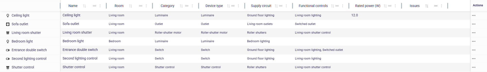
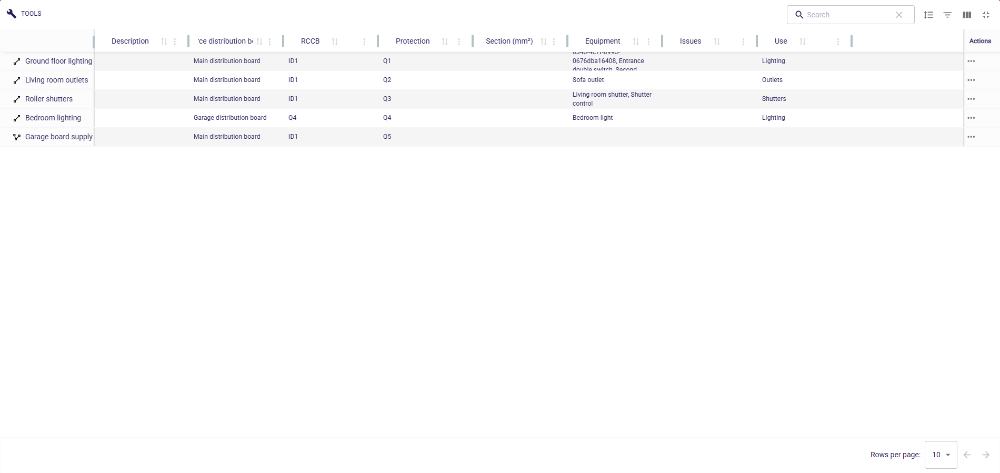
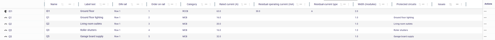
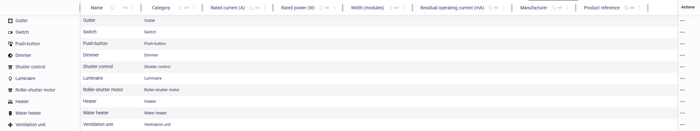

<!--
Copyright (c) 2026 Laurent Redor.
This program and the accompanying materials
are made available under the terms of the Eclipse Public License v2.0
which accompanies this distribution, and is available at
https://www.eclipse.org/legal/epl-2.0/

SPDX-License-Identifier: EPL-2.0
-->

# HED - Home Electrical Designer

A Sirius Web modeler for residential electrical installations. English is the default language; French domain translations are included.

> **Developed with Codex:** This modeler was implemented by OpenAI Codex, under Laurent Redor's direction and review.

The initial scope covers rooms, outlets, control devices, electrical loads, distribution boards, DIN rails, protective devices, final/distribution circuits and their branches, functional controls and an editable device catalog. Equipment and circuits use a single name. Modular devices take their technical specifications from their catalog type and must be mounted on a rail within its capacity. This is a design and documentation tool; it does not certify compliance with NF C 15-100.

## Domain build

Requirements: JDK 21 or later and Maven 3.9.9 or later.

```sh
mvn verify
```

The model and edit adapters are generated from the Ecore source. Regenerate from the repository root:

```sh
mvn -f tools/codegen/pom.xml compile exec:java
mvn verify
```

Commit the generated sources alongside Ecore changes. Handwritten domain operations and validation live outside the generated package.

The generator sets `GenModel.copyrightText` so generated model and edit sources retain the copyright and SPDX license headers after regeneration. `copyrightFields` stays disabled; the full EPL-2.0 notice is emitted in file headers rather than as Java constants. The generation entry point also normalizes generated Java to four-space indentation with explicit conditional/loop braces, and formats its XML metadata as UTF-8. `.editorconfig` defines shared encoding and indentation conventions.

See [the metamodel and editing rules](doc/metamodel.md).

## Sirius Web application

The `application` Maven profile adds the Sirius Web 2026.9.0 backend and the standard React frontend. It provides empty/sample dwelling templates, the domain explorer, contextual creation and deletion, editable properties, four electrical tables, domain validation and local pictograms.

Build the frontend before packaging the application, then run it against PostgreSQL. See [building, configuration and the first modeling workflow](doc/development.md). English is the default; set `HED_LOCALE=fr_FR` for French. New catalog names use the creation language and remain editable user data afterward.

## Docker launch

Docker builds the frontend and backend from source, runs the Maven tests, and starts the application with PostgreSQL. See [the Docker launch and persistence workflow](doc/docker.md) and [GitHub Packages access](doc/github-packages.md).

## Model Explorer

Use Model Explorer to create, rename and delete model elements, inspect their properties and open saved representations.

If another explorer is active, choose **Electrical installation** in the explorer selector to use the domain projection. Its root is the native project name, with **Dwelling**, **Electrical service area (GTL)** and **Device catalog** beneath it. Storeys, rooms and functional controls are under Dwelling; the service connection, distribution boards and circuits are under the GTL. The catalog separates **Distribution board devices** from **Terminal equipment**.

Create a distribution board from the GTL, then rails on the board and appliances directly on a rail. See [the hierarchy and contextual creation menus](doc/model-explorer.md).

See [reordering rails and mounted devices](doc/explorer-reordering.md) for Model Explorer movement commands.

### Model pictograms

The explorer, creation menus and reference selectors share the local [Material Design Icons selection](doc/icons.md), with visual previews and author credits. The SVGs retain their upstream licenses.

## Representations

The same residential electrical model can be viewed through several representations. Each representation is associated with a model element and shares its data with Model Explorer and Properties. Table columns can be resized to suit the information being displayed. Create a view using **New representation** on its owner in Model Explorer. Saved representations appear beneath that owner and can be opened, renamed or deleted there; deleting a representation preserves the model element.

See [table creation and editing](doc/tables.md) for the available columns and editing rules.

### Equipment Table

Create this table on a **Dwelling**. It lists terminal equipment, rooms, catalog types, circuits, functional controls and power ratings. Names and power ratings can be edited inline.



### Circuit Table

Create this table on a **Dwelling**. It shows circuit uses, source boards, protective devices, conductor cross-sections and served equipment. Names and conductor cross-sections can be edited inline.



### Distribution Board Table

Create this table on a **DistributionBoard**. It shows rail assignments, catalog types and protective-device specifications. The read-only **Upstream protection** column shows each device's direct supply (RCCB or service circuit-breaker). Names and label text can be edited here; catalog-owned specifications remain read-only on instances.



### Device Catalog Table

Create this table on a **Catalog**. It lists the available device types, their ratings, module widths, manufacturers and product references. Editing a type updates the specifications displayed for its instances.



## References

- [Sirius Web 2026.9.0](https://github.com/eclipse-sirius/sirius-web/tree/v2026.9.0)
- [Ontology reference application](https://github.com/ObeoNetwork/ontology)

Local reference photographs in `tempImagesNotInConf/` are preserved and excluded from Git. They are not bundled with the application.

## Shared formatting

Java sources use the **Sirius** Eclipse formatter profile from Sirius Web 2026.9.0 (`tools/style/JavaFormatter.xml`), four spaces and its 200-column code target. Generated and handwritten sources use explicit imports, including static imports, and braces around conditional/loop bodies. UTF-8 is retained for accented text.

Maven runs the formatting-related Checkstyle rules during `validate`, including for tests and generated Java. The Checkstyle configuration is adapted from Sirius Web; design/complexity rules are outside this formatting policy. The original Eclipse cleanup profile is also available under `tools/style`.

From the repository root, apply the shared Java formatter:

```sh
mvn -f tools/codegen/pom.xml compile exec:java '-Dexec.mainClass=hed.codegen.SourceFormatting' '-Dexec.args=.'
```

Check without modifying files:

```sh
mvn -f tools/codegen/pom.xml compile exec:java '-Dexec.mainClass=hed.codegen.SourceFormatting' '-Dexec.args=--check .'
```

The formatting workflow runs the same checks on pushes and pull requests. The generation entry point also applies this profile and preserves the complete copyright header and explicit generated imports.

## License

Copyright (c) 2026 Laurent Redor.

Home Electrical Designer is made available under the [Eclipse Public License 2.0](LICENSE). See [NOTICE](NOTICE) for attribution information. The Maven model, edit, starter and application artifacts include both files under `META-INF/`. Third-party components retain their respective licenses and copyright notices.
