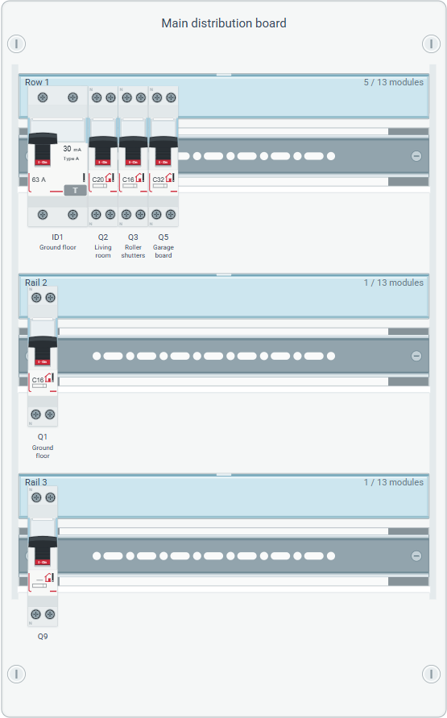

<!--
Copyright (c) 2026 Laurent Redor.
This program and the accompanying materials
are made available under the terms of the Eclipse Public License v2.0
which accompanies this distribution, and is available at
https://www.eclipse.org/legal/epl-2.0/

SPDX-License-Identifier: EPL-2.0
-->

# Distribution Board Layout

Create this diagram on a **DistributionBoard** in Model Explorer: **New representation → Distribution Board Layout** (French: **Nouvelle représentation → Implantation du tableau**). Saved diagrams appear under their board in the explorer and can be reopened there.

The cabinet contains its DIN rails in model order. Devices are placed from left to right using each rail's ordered `devices` reference. Widths come from the catalog type's module count. Unknown widths use the domain default illustration width. Each rail displays its name and occupied/available module counts. A modular device is always mounted on a rail. Rail names and module counts sit five pixels below the top of each row, beneath the SVG label holder's white highlight.

## Editing

- Drag a modular catalog type from Model Explorer onto a DIN rail or one of its mounted modular devices to create a new modular device at the end of that rail. Available capacity is required; the type stays in the catalog. See [catalog drops and accepted types](model-explorer.md#create-modular-devices-from-the-catalog).

- Drag a modular device onto another modular device to take its position. Moving to the right inserts after the target; moving to the left inserts before it.
- Drop onto a rail's empty area to append the modular device at the end, including its current rail. A full rail can be reordered because its occupancy stays unchanged. Transfers remain within the same board and require enough available capacity on the destination.
- Model Explorer's [movement commands](explorer-reordering.md) reorder rails vertically and mounted devices horizontally. The diagram and board table follow these ordered references.
- Select a modular device and press **Delete** and confirm the dialog to remove its model element, or use the native diagram delete action. Rails and the cabinet cannot be deleted from the diagram.
- Create or delete rails and devices through Model Explorer. Edit their names, label text, catalog types, circuit and upstream protection assignments in Properties. Device technical specifications come from the catalog.

Positions inside the cabinet are calculated from rail and device order. Free coordinates do not override the model's physical sequence. Reordering preserves object identity and electrical assignments; reopening the diagram restores the constrained arrangement. Device captions use their stored name; an empty or whitespace-only name produces no caption or empty label container. Label text is displayed separately beneath the name.

## Canva artwork

The project bundles the user's editable SVGs as application resources:

| Canva source | Application resource |
| --- | --- |
| `tableau-electrique-3-rails-editable.svg` | `hed/panel/cabinet.svg` |
| `disjoncteur-C16-editable.svg` | `hed/panel/mcb.svg` |
| `interrupteur-differentiel-63A-30mA-editable.svg` | `hed/panel/rccb.svg` |
| `telerupteur-16A-editable.svg` | `hed/panel/relay.svg` |

The cabinet background and its DIN rail shapes come from SVG. The server repeats the row group and extends the original frame for the board's rail count. Geometry follows the artwork's anchors: width 1200, first rail center at y=420, row origin (48,198), and device area x=72..1128. The rendering keeps a fixed 38-pixel module width and a minimum 252-pixel row pitch to fit devices and captions. Wider rail capacities scale the cabinet horizontally.

The device SVG endpoint substitutes actual catalog current ratings, trip curves, residual-current sensitivity and manufacturer text. RCCBs also display their catalog differential type (for example **Type A** or **Type AC**) below the sensitivity. Unknown values remain unknown; other modular categories use a neutral placeholder. RCBOs use the circuit-breaker illustration with their residual-current marking. SVG text substitutions escape XML special characters. The local Canva working files remain separate from application resources.

## Implementation and verification

The backend lives in `hed.starter.representations.diagrams.panel`; the frontend renderer and layout live in `frontend/src/representations/diagrams/panel`. `PanelDiagram` defines the native Sirius Web View DSL diagram. `PanelNodeStyleProvider` supplies presentation metadata through the standard custom node-style extension. A GraphQL style fragment, node converter and layout handler are registered with `DiagramRepresentationConfiguration`. Native drop tools invoke the existing domain operations. Catalog creation uses `CatalogDropService` and the custom node renderer delegates external drags to Sirius Web's [native `useDrop` hook](https://github.com/eclipse-sirius/sirius-web/blob/v2026.9.0/packages/diagrams/frontend/sirius-components-diagrams/src/renderer/drop/useDrop.tsx), passing the destination node identifier. No custom mutation endpoint or database is needed.

Sirius Web's [native drop handler](https://github.com/eclipse-sirius/sirius-web/blob/v2026.9.0/packages/diagrams/frontend/sirius-components-diagrams/src/renderer/dropNode/useDropNodes.ts) skips the semantic drop tool when the target is the node's current parent. `PanelRailDrop` handles this one gesture through `diagramRendererReactFlowPropsCustomizerExtensionPoint`, invoking the native `dropNodes` mutation after native drag cleanup. The existing rail drop tool then appends the device through the domain operation. Read-only diagrams and other drop gestures retain their native handling.

The integration follows Sirius Web **2026.9.0**'s [custom ellipse style provider](https://github.com/eclipse-sirius/sirius-web/blob/v2026.9.0/packages/sirius-web/backend/sirius-web-application/src/main/java/org/eclipse/sirius/web/application/diagram/services/EllipseNodeStyleProvider.java). The custom layout is needed to enforce module widths and semantic rail/device order. Existing table representation identifiers stay stable when the diagram is appended to the view.

Tests cover SVG row counts and unique identifiers, cabinet dimensions, catalog-owned artwork values, XML text escaping, dropped-device transfers and rejected edits. The bilingual `panel.spec.ts` browser workflow creates three rails, checks SVG/module alignment, appends a device on its current full rail, reorders and transfers devices, verifies explorer synchronization and protection links, and reopens the saved diagram. It also checks that empty and whitespace-only names render no caption, that RCCB types appear on the artwork, and that Delete removes a modular device from the model and explorer after reopening. Test projects are uniquely named and deleted after each workflow.
